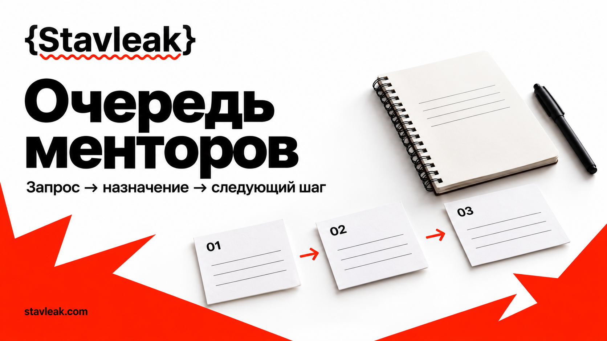

<p><a href="https://stavleak.com/ru"><picture><source media="(prefers-color-scheme: dark)" srcset="assets/stavleak-logo-dark.svg"></picture></a></p>

# Очередь менторской помощи на хакатоне



Команда просит помощи в чате, ментор отвечает в личных сообщениях, а следующая смена не знает, кто ещё ждёт. Этот комплект превращает обращения в одну закрытую очередь: каждый запрос получает номер, владельца, срок следующего действия и понятный исход.

**Цель репозитория:** провести запрос от получения до помощи или объяснённого следующего шага, сохранив проверяемый порядок обслуживания. Комплект подходит для хакатона, дататона или другого события с короткими консультациями. Приложение ведёт очередь через формы; таблицы и карточки дополняют его при подготовке смены.

[Stavleak](https://stavleak.com/ru) помогает организациям проводить хакатоны и предоставляет рабочую среду события. Эти материалы можно взять отдельно и адаптировать под свою команду.

<!-- stavleak:application -->
## Рабочее приложение

В репозитории есть интерфейс на **Next.js** и сервер на **Rust**. Создавайте реальные записи через формы: сервер проверяет их и сохраняет в локальный файл. Начальное состояние пустое; учебные данные загружаются отдельной кнопкой с подтверждением.

Нужны Node.js 22+, pnpm 10.33.0 и установленный Rust 1.88+ с системным линкером. В Windows стандартному Rust MSVC нужны Visual Studio Build Tools с компонентом Desktop development with C++; в Linux — C/C++ toolchain.

```sh
pnpm install --frozen-lockfile
pnpm setup
pnpm dev
```

`pnpm setup` предложит задать пароль и создаст случайные серверные ключи в игнорируемом `.env.local`. Откройте **http://127.0.0.1:3005/ru** и войдите с выбранным паролем. Одновременно работает одно приложение на стандартных портах 3005 и 3006.

Данные сохраняются в `data/state.json`. Обновление устаревшей версии возвращает конфликт, а закрытые предметные записи защищены серверными правилами. Пароль, ключи и рабочие данные не входят в публичный репозиторий. [Возможности и сценарии](docs/application.md) · [Запуск, резервные копии и границы доступа](docs/local-operation.md).

Проверка: `pnpm check`; сборка интерфейса: `pnpm build`; рабочий запуск сборки: `pnpm start`. Приложение рассчитано на одну закрытую локальную рабочую среду организатора. Русский интерфейс находится по `/ru`; переводы на другие языки пока не созданы.

Шаблоны и примеры ниже дополняют приложение. CSV-файлы не импортируются и не синхронизируются автоматически: используйте их отдельно либо переносите нужные записи через формы.

## Как понять, что комплект сработал

До открытия очереди утвердите локальные цели в [настройках](templates/event-settings.md). Предлагаемые условия приёмки ниже являются целями работы, а не результатами клиентов и не обещанием времени ответа Stavleak:

- У каждого незавершённого запроса заполнены владелец, срок и следующее действие. Проверяйте все открытые строки при каждой передаче смены.
- Каждое обращение подтверждено номером или явно объединено с существующим запросом. Для репетиции используйте локальный ориентир в три минуты.
- Каждый пропуск более раннего подходящего запроса объяснён в журнале решений. «Команда знакома ментору» не является причиной.
- Каждая передача имеет подтверждение нового владельца. До него ответственность остаётся у прежнего.
- Каждый закрытый запрос имеет время и причину закрытия; открытые запросы не закрываются только потому, что закончилась смена.

Скорость помощи измеряйте отдельно: время до подтверждения, время от готовности вопроса до начала первой консультации, число переносов и запросов без подходящего специалиста. В [шаблоне итогов](templates/closeout-metrics.csv) оставлены пустые результаты: заполните их наблюдениями своей смены.

## Быстрый старт за 15 минут

1. **0–3 минуты.** Назначьте диспетчера и сменного руководителя. Скопируйте [настройки события](templates/event-settings.md) в закрытые рабочие документы. Укажите часовой пояс, канал запросов, резервный канал и часы работы.
2. **3–6 минут.** Импортируйте [список менторов](templates/mentor-roster.csv) как UTF-8 CSV с разделителем `,`. Запишите подтверждённые интервалы, темы, языки, код ментора и место консультации. Контакты храните отдельно с ограниченным доступом.
3. **6–9 минут.** Импортируйте [очередь](templates/queue.csv) и [журнал решений](templates/queue-decisions.csv) в закрытую таблицу. Диспетчер остаётся единственным редактором очереди; менторы передают ему обновления по согласованному каналу. Прочитайте [словарь столбцов](docs/data-dictionary.md).
4. **9–12 минут.** Опубликуйте участникам правила из настроек: как подать вопрос, получить номер и узнать следующее обновление. Используйте [карточку запроса](templates/request-card.md). В публичный канал можно выводить только обезличенный номер, состояние и время следующего обновления из [шаблона статуса](templates/public-status.csv).
5. **12–15 минут.** Прогоните сокращённую [репетицию](docs/rehearsal.md): два запроса, занятый ментор, передача без ответа. Сверьте ожидаемый порядок и чеклист смены. Если потерялся владелец или время, исправьте порядок до открытия.

Все CSV-шаблоны содержат только заголовки. Добавьте собственные строки в закрытой копии. Время записывайте целиком с датой и смещением, например `2026-10-10T10:00:00+05:00`; дата примера вымышлена. При импорте задайте идентификаторам и временным меткам текстовый тип, чтобы редактор не переписал их.

## Что находится в репозитории

| Файл | Практическое применение |
|---|---|
| [Регламент очереди и маршрутизации](docs/queue-policy.md) | Однозначный порядок назначения, ограничение сессии, переносы, исключения |
| [Словарь данных](docs/data-dictionary.md) | Значения состояний, обязательные поля и способ считать ожидание |
| [Репетиция](docs/rehearsal.md) | Проверка очереди, отсутствующего ментора, смены и резервного канала |
| [Настройки](templates/event-settings.md) | Кто отвечает и какие сроки выбраны для конкретного события |
| [Карточка запроса](templates/request-card.md) | Один вопрос, ожидаемый результат, безопасный контекст |
| [Список менторов](templates/mentor-roster.csv) | Подтверждённая доступность и компетенции |
| [Очередь](templates/queue.csv) | Владелец, срок и следующее действие каждого запроса |
| [Журнал решений](templates/queue-decisions.csv) | Изменения маршрута, исключения, переходы состояний |
| [Итог сессии](templates/session-outcome.md) | Что проверили и что команда делает дальше |
| [Приём смены](templates/shift-handover.md) | Проверка открытых запросов и явное подтверждение ответственности |
| [Статус для участников](templates/public-status.csv) | Минимальная обезличенная проекция очереди |
| [Итоги смены](templates/closeout-metrics.csv) | Измерения с числителем, знаменателем и ограничениями |
| [Пример 1: порядок обслуживания](examples/01-fifo.md) | Заполненная очередь и решение при разной компетенции |
| [Пример 2: смена и отсутствие специалиста](examples/02-handover.md) | Подтверждённая передача и честный следующий шаг |

## Ограничения и приватность

Организационные материалы требуют закрытого рабочего хранилища; локальное приложение использует отдельный пароль смены. Доступ к рабочей таблице, карточкам и контактам настройте у своего провайдера. Номер запроса служит для общения и не является паролем. Реальные очереди, записи консультаций, сообщения участников и ссылки на закрытые комнаты **не помещайте в публичный GitHub**, Issues, Pull Requests или screenshots.

В репозитории оставляйте пустые шаблоны и вымышленные примеры. Для рабочих карточек достаточно внутреннего кода команды; связь с человеком хранится в закрытом справочнике. Не собирайте телефон, диагноз, документ или причины специальных условий в очередь. До события назначьте срок удаления рабочих данных и ответственного; после него проверьте также экспортированные копии и доступы.

Изменение правил помощи, допуск к данным и конфликт интересов решает организатор. Ментор не обещает оценку жюри, не подменяет участника и не принимает решение за команду. Пределы помощи необходимо согласовать с регламентом события.

Все истории, коды и даты в `examples/` вымышлены. Формат очереди и параметры по умолчанию являются редакционным предложением Stavleak, которое организатор проверяет на репетиции.

## Изменения и права

[Как предложить улучшение](CONTRIBUTING.md). Лицензия материалов указана в [LICENSE](LICENSE); правила для фирменных файлов указаны отдельно в [NOTICE.md](NOTICE.md). Логотип Stavleak и обложка не переходят под лицензию текстов и шаблонов: их наличие не даёт права выдавать своё событие за событие Stavleak или объявлять партнёрство.

Хотите провести хакатон на Stavleak? Начните с [сайта Stavleak](https://stavleak.com/ru).

<!-- stavleak:brand-footer -->
[Stavleak](https://stavleak.com/ru) · [Материалы организатора](https://org.stavleak.com/ru#toolkit)

<!-- stavleak:related-kits -->
## Другие задачи организатора

- [Смены волонтёров](https://github.com/Stavleak/hackathon-volunteer-shift-kit)
- [Ответы участникам](https://github.com/Stavleak/hackathon-participant-comms-kit)
- [Репетиция события](https://github.com/Stavleak/hackathon-event-rehearsal-kit)
- [Из демо в пилот](https://github.com/Stavleak/hackathon-pilot-handover-kit)
